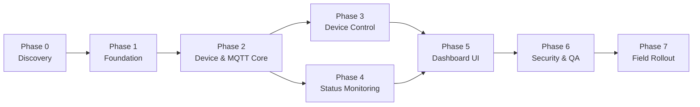

# Implementation Plan – LoRa Highway LED Control & Monitoring System

2026-09-18 · @Someone

## Document Control

| Field | Value |
| --- | --- |
| Document Title | Implementation Plan – LoRa Highway LED Control & Monitoring System |
| Version | 0.1 (Draft) |
| Status | **DRAFT** — durations are placeholders pending team sizing and Open Issue resolution |
| Related Documents | PRD v0.1, SRS v0.1 (Node.js / Vue.js / MySQL) |
| Date | 2026-09-18 |

## Purpose & Approach

This plan sequences the SRS's functional and non-functional requirements into an executable build order: **8 phases**, from open-issue resolution through field rollout. It does not restate requirements (see SRS §4–§12) — it states **what gets built when, in what order, and why that order**.

### Guiding Principles

1. **Resolve blocking unknowns before writing dependent code.** Several SRS Open Issues (§13) — brightness range, MQTT topic structure, stack library choices — gate specific phases below; each phase lists exactly which open issues it depends on.
2. **Source-of-truth firmware stays untouched by default.** No phase modifies embedded behavior; firmware changes only enter scope if Phase 0 explicitly approves a "Possible Firmware Enhancement" from the PRD.
3. **Build bottom-up through the stack per feature slice**, not layer-by-layer: each phase after Foundation delivers a working MySQL → Node.js → Vue.js slice (e.g. "individual device control" end-to-end) rather than "all backend, then all frontend."
4. **Security and audit trail are not a late phase** — auth/RBAC lands in Phase 1 (Foundation) since every later phase depends on it.

### Indicative Team Roles

| Role | Responsibility |
| --- | --- |
| Backend Engineer(s) | Node.js API, MQTT integration, command lifecycle |
| Frontend Engineer(s) | Vue.js dashboard |
| Database/DevOps | MySQL schema, migrations, hosting, CI/CD |
| Embedded/Firmware Liaison | Confirms protocol details against real firmware, does not modify it unless scoped |
| QA | Executes SRS §12 test cases, UAT coordination |
| Project/Product Owner | Resolves Open Issues, signs off on each phase's Definition of Done |

Team size and exact staffing are **TBD** — not assumed here.

## Phase 0 — Discovery & Open-Issue Resolution

**Goal:** eliminate the unknowns that block Phase 1+ before any production code is written.

| Task | Blocks |
| --- | --- |
| Obtain and review complete `integration_protocol.doc` and `RYLR998_TX_TEST.ino` | Everything in Phase 2–4 (protocol correctness) |
| Resolve brightness range conflict (1–99 firmware vs. 0–100% protocol) with client/embedded team | Phase 3 (Device Control) |
| Resolve MQTT topic relationship: `esp/sub`/`esp/pub` vs. `Factory/Lighting/Device<Address>/...` | Phase 2 (MQTT Integration) |
| Decide Node.js framework (Express/Fastify/NestJS) | Phase 1 |
| Decide ORM/query layer (Sequelize/Prisma/Knex/`mysql2`) | Phase 1 |
| Decide auth mechanism (JWT vs. session store) and password hashing library | Phase 1 |
| Decide Vue.js version (2 vs. 3) and state management (Pinia/Vuex) | Phase 1 |
| Decide MySQL hosting (managed vs. self-hosted) and version | Phase 1 |
| Decide real-time update channel (polling vs. WebSocket/SSE) | Phase 4–5 |
| Confirm final MQTT broker product/version and receivers-per-transmitter limit | Phase 2 |
| Define default monitoring parameters (polling interval, offline threshold, retry count, response timeout) or confirm they launch as admin-set-on-first-use | Phase 4 |

**Definition of Done:** every row above has an answer recorded (in this document or a linked decision log); SRS §13 Open Issues updated to reflect resolutions. No Phase 1 work starts until the Phase-1-blocking rows are closed.

## Phase 1 — Foundation

**Goal:** a running, empty skeleton — Vue.js talks to Node.js talks to MySQL, with login and roles working, before any device logic exists.

### 1.1 Repository & Project Scaffolding

- Initialize Node.js backend project (framework per Phase 0 decision), linting/formatting config, environment-variable handling for secrets (MQTT/DB credentials, per SRS SEC-007).
- Initialize Vue.js frontend project (SPA, router, chosen state library), API client wrapper module.
- Basic CI: install, lint, run tests on push (pipeline tool TBD, Phase 0).

### 1.2 MySQL Schema & Migrations

- Create initial migration set for core tables: `users`, `roles`, `transmitters`, `receivers`, `groups`, `group_members` (per SRS §10.1). Command/status/audit tables land in later phases as those features are built, to avoid schema churn.
- Seed script for initial Admin user and role rows.

### 1.3 Authentication & RBAC (SRS §8.3)

- `POST /api/auth/login` — credential check, password hash verification, token/session issuance.
- Node.js auth middleware enforcing role checks on protected routes (FR-AUTH-003) — built and tested here so every later endpoint can rely on it.
- Vue.js login page, route guards (UX convenience layer, not the security boundary).

**Definition of Done:** an Admin user can log in through the Vue.js UI, receive a valid session, and hit one protected Node.js endpoint that correctly rejects an unauthenticated or wrong-role request. TC-001, TC-002, TC-011 pass.

## Phase 2 — Device & MQTT Integration Core

**Depends on:** Phase 0 resolution of MQTT topic relationship and broker choice; Phase 1 auth/schema foundation.

**Goal:** the backend can register devices and receive real telemetry from a transmitter — before any command can be sent.

### 2.1 Device/Transmitter/Receiver Management (SRS §4.1, FR-DEV)

- `transmitters`/`receivers` migrations (device\_id, lora\_address, network\_id, parent\_transmitter\_id, location, per SRS §4.4 addressing model — device\_id kept distinct from lora\_address).
- `GET/POST/PUT /api/devices` endpoints with RBAC (Admin add/edit, all roles view).
- Vue.js Device Management page (Admin) and read-only Highway/Junction tree view (SRS FR-UI-003/004).

### 2.2 MQTT Client Service (SRS §4.3, FR-MQTT)

- Node.js persistent MQTT client (library per Phase 0), subscribing to `esp/pub/<address>` for every registered receiver's parent transmitter address.
- Parse and store incoming ACK/status JSON (`{source, message, rssi, snr}`, `{relay1, relay2, brightness}`) exactly as documented — no invented fields.
- Reconnection/backoff handling (TC-010).

### 2.3 Basic Status Ingestion

- `device_status` table populated from incoming MQTT messages (latest snapshot per receiver).
- `GET /api/devices/{id}/status` endpoint returning the current snapshot.

**Definition of Done:** a receiver registered in the dashboard shows live RSSI/SNR/relay/brightness values sourced from real (or simulated) MQTT traffic, without any command yet being sent from the dashboard. TC-009 passes.

## Phase 3 — Device Control

**Depends on:** Phase 0 resolution of brightness range and group transmission mechanism; Phase 2 MQTT service.

**Goal:** an operator can control a real device end-to-end, individually and in groups, with full traceability.

### 3.1 Individual Device Control (SRS §5.1, FR-CTL)

- `POST /api/devices/{id}/commands` — validates command/parameter (brightness range per Phase 0 resolution), builds `Tx_<address>_<command>` string, publishes to `esp/sub/<address>`.
- Command lifecycle state machine (`CREATED→QUEUED→SENT_TO_TRANSMITTER→SENT_OVER_LORA→ACKNOWLEDGED→SUCCESS`, plus failure states) persisted to `commands` table.
- Vue.js `BrightnessSlider.vue` / `RelayToggle.vue` / `CommandResult.vue` wired to the endpoint.

### 3.2 Command Audit Trail (SRS §5.4, FR-AUDIT)

- Every command write captures user\_id, role, transmitter/receiver, parameter, source, status, RSSI/SNR, final result, error code.
- `GET /api/audit` + Vue.js `AuditLogTable.vue`.

### 3.3 Group Control (SRS §5.2–5.3, FR-GRP)

- `groups`/`group_members` CRUD, `POST /api/groups/{id}/commands` fanning out to each member device individually.
- Per-device result tracking in `command_results`; aggregate `SUCCESS`/`PARTIAL_SUCCESS`/`FAILED` computed in Node.js.
- Vue.js Group Management page and `CommandResult.vue` partial-success rendering (SRS §7.2).

**Definition of Done:** TC-003 (brightness), TC-004 (individual isolation), TC-005 (group), TC-006 (partial group failure) all pass against real or simulated hardware.

## Phase 4 — Status & Health Monitoring

**Depends on:** Phase 0 default monitoring parameters; Phase 2 telemetry ingestion.

**Goal:** the dashboard reliably shows which devices are online/offline, and Admins can tune how that's decided.

### 4.1 Heartbeat Ingestion (SRS §6.1/6.3, FR-MON/FR-HB)

- `heartbeats` table populated from MQTT heartbeat messages (30s protocol interval).
- Kept as a record distinct from status responses and command ACKs — never merged into one field.

### 4.2 Online/Offline Determination (SRS §6.4, FR-ONOFF)

- Node.js logic combining MQTT retained/LWT state, last heartbeat, last status response, and configured offline threshold into a single `online`/`offline` value.
- Start with the placeholder rule noted in the SRS ("last-seen exceeds threshold → offline") and flag it explicitly as provisional pending Phase 0/embedded-team confirmation.

### 4.3 Admin-Configurable Monitoring (SRS §6.2, FR-MONCFG)

- `monitoring_config` table + `GET/PUT /api/status-monitoring`.
- Vue.js `MonitoringConfigForm.vue` (Admin-only) for enable/disable, polling interval, response timeout, retry count, offline threshold.
- Optional scheduled polling job (`node-cron` or equivalent) if polling mode (vs. pure push) is confirmed in Phase 0.

### 4.4 Status Dashboard Feed

- `StatusTable.vue` / `RssiSnrBadge.vue` consuming `GET /api/devices/{id}/status`; Main Dashboard summary cards (online/offline counts, active faults, recent commands).

**Definition of Done:** TC-007 (status monitoring), TC-008 (offline detection) pass; Admin can change the offline threshold from the UI and observe the dashboard's determination change accordingly.

## Phase 5 — Dashboard UI Build-out

**Depends on:** Phases 1–4 (each page's backing API must already exist).

**Goal:** every page in SRS §7 is complete, polished, and role-aware — most of the underlying data plumbing already exists from earlier phases, so this phase is primarily UI completion, not new backend work.

| Page | Status entering Phase 5 | Remaining work |
| --- | --- | --- |
| Login | Built in Phase 1 | Polish, error states |
| Main Dashboard | Data feed from Phase 4 | Summary cards, recent commands widget |
| Highway/Junction View | Built in Phase 2 | Tree UX, filtering |
| Device Management | Built in Phase 2 | Full CRUD forms, validation |
| Device Control | Built in Phase 3 | Full brightness/relay UX, result feedback |
| Group Management | Built in Phase 3 | Group CRUD UX, member picker |
| Status Monitoring | Built in Phase 4 | Table UX, RSSI/SNR badges |
| Configuration (Admin-only) | Built in Phase 4 | LoRa/MQTT config forms (read-only display of existing firmware config per PRD §6, since those values are not dashboard-editable unless Phase 0 scoped a firmware change) |
| User Management | Partial (auth exists from Phase 1) | Full user CRUD, role assignment, password reset UX |
| Logs | Built in Phase 3 (`AuditLogTable.vue`) | Command logs, device logs, communication logs, configuration-change logs, error logs consolidated |

**Definition of Done:** every SRS §7 page is navigable, role-gated, and backed by real data; a full Admin/Operator/User walkthrough covers every function in the Role-Permission Matrix (SRS §8.2).

## Phase 6 — Security Hardening, Testing & QA

**Depends on:** Phases 1–5 feature-complete.

**Goal:** close the gap between "works in the happy path" and "safe to expose to real highway infrastructure."

### 6.1 Security Hardening (SRS §11.2)

- HTTPS enforced end-to-end (SEC-001).
- Verify parameterized queries throughout — no string-built SQL anywhere (SEC-004).
- Confirm Vue.js cannot reach any raw AT/LoRa command path; only the validated Node.js command API can (SEC-008, **critical**).
- Session/token expiry enforced and tested (SEC-005).
- Secrets audit: confirm no MQTT/MySQL credentials in source control (SEC-007).

### 6.2 Full Test Suite Execution (SRS §12.1)

Run TC-001 through TC-012 end-to-end, including negative/adversarial cases: unauthorized API calls bypassing the UI (TC-011), SQL injection attempts (TC-012), MQTT disconnect/reconnect (TC-010).

### 6.3 User Acceptance Testing (UAT)

- Client/stakeholder walkthrough of every dashboard page against the PRD's stated objectives (PRD §1).
- Sign-off against the Role-Permission Matrix and the Open Issues that were resolved in Phase 0 — confirm nothing was silently reinterpreted.

### 6.4 Bug Fixing & Regression

Triage and fix defects found in 6.2/6.3; re-run affected test cases.

**Definition of Done:** all test cases in SRS §12.1 pass; UAT sign-off obtained from the client; no open SEC-tagged findings.

## Phase 7 — Field Deployment & Rollout

**Depends on:** Phase 6 sign-off; Phase 0 hosting decision.

**Goal:** move from a tested application to a system running against real highway hardware, safely and incrementally.

### 7.1 Hosting & Environment Setup

- Provision Node.js hosting, MySQL instance, and MQTT broker per Phase 0 decisions.
- Configure HTTPS certificates, environment secrets, backups (MySQL backup/retention policy — TBD, PRD §6).

### 7.2 Pilot Junction Validation

- Deploy against **one** real transmitter + a small set of receivers at a single junction before wider rollout.
- Validate the PRD's \~1 km LoRa range assumption on-site (PRD §3) — record actual observed range, RSSI/SNR under real conditions.
- Confirm brightness range, MQTT topic behavior, and heartbeat timing exactly match what Phase 0 resolved — flag any drift from the documented protocol immediately rather than patching around it silently.

### 7.3 Staged Rollout

- Expand junction-by-junction only after the pilot junction runs stably for an agreed observation period (duration **TBD**).
- Each new junction registered through the Device Management UI (Phase 2/5), not manually in the database.

### 7.4 Handover & Training

- Admin/Operator training on the dashboard.
- Runbook for common failure modes (SRS §11.3): MQTT disconnects, receiver offline, partial group failures.
- Handover of Open Issues that remain deliberately deferred (e.g. OTA firmware updates, PRD §16) as a documented backlog, not silently dropped.

**Definition of Done:** the pilot junction operates stably against real hardware for the agreed observation period; rollout plan for remaining junctions is approved by the client.

## Timeline & Dependencies

Durations below are **placeholder estimates**, not commitments — they assume a small dedicated team and must be re-sized once Phase 0 confirms staffing and scope.

Note: Phase 3 (Device Control) and Phase 4 (Status Monitoring) can run **in parallel** once Phase 2 is complete, since they depend on different parts of the MQTT/telemetry foundation but not on each other.

| Phase | Placeholder Duration | Depends On |
| --- | --- | --- |
| 0 — Discovery | 1–2 weeks | — |
| 1 — Foundation | 1–2 weeks | Phase 0 |
| 2 — Device & MQTT Core | 2–3 weeks | Phase 1 |
| 3 — Device Control | 2 weeks | Phase 2 |
| 4 — Status Monitoring | 2 weeks (parallel with Phase 3) | Phase 2 |
| 5 — Dashboard UI Build-out | 2–3 weeks | Phase 3 & 4 |
| 6 — Security, Testing & QA | 1–2 weeks | Phase 5 |
| 7 — Field Deployment & Rollout | Ongoing, pilot-first | Phase 6 |

**All durations TBD-confirm with the delivery team; this table exists to show sequencing and parallelism, not to commit a schedule.**

## Risks & Mitigations

| Risk | Impact | Mitigation |
| --- | --- | --- |
| Full `integration_protocol.doc` / `RYLR998_TX_TEST.ino` never fully supplied | Phase 2–3 built on incorrect protocol assumptions | Phase 0 is a hard gate — do not start Phase 2 without full source review; flag every assumption explicitly in code comments and this doc |
| Brightness range conflict (1–99 vs 0–100%) unresolved past Phase 0 | Phase 3 brightness control may be silently wrong in the field | Escalate to embedded/client team before Phase 3 starts; do not guess |
| Real-world LoRa range falls short of \~1 km target | Receivers unreachable at planned junction spacing | Validate in Phase 7.2 pilot **before** wide rollout; PRD already frames 1 km as nominal, not guaranteed |
| Stack decisions (framework/ORM/auth/state mgmt) drag past Phase 0 | Phase 1 blocked, cascading delay | Timebox Phase 0 decisions; assign a single decision-owner (Product/Tech Lead) |
| MQTT topic unification (`esp/sub` vs `Factory/Lighting/...`) attempted mid-build instead of resolved upfront | Rework in Phase 2/3 command-building logic | Resolve in Phase 0; Phase 2 builds against the confirmed topic set only |
| Group command mechanism assumed rather than confirmed | Phase 3 group control may not match real transmitter capability | Confirm sequential-vs-broadcast behavior with embedded team before Phase 3.3 |
| Security requirements treated as "Phase 6 only" | Auth/RBAC retrofitted late, higher rework cost | This plan places auth/RBAC in Phase 1 specifically to avoid this |
| Field connectivity (Fiber/GSM/LAN) not finalized per site | Phase 7 rollout delayed per junction | Confirm connectivity type junction-by-junction as part of Phase 7.3 staged rollout, not assumed uniform |

### Overall Definition of Done (project-level)

All SRS functional requirements (§4–§8) implemented and tested; all SRS non-functional requirements (§11) addressed or explicitly deferred with client sign-off; PRD Open Issues (§13 in SRS) either resolved or captured as an accepted backlog; pilot junction stable in the field; Admin/Operator users trained and handed off.
