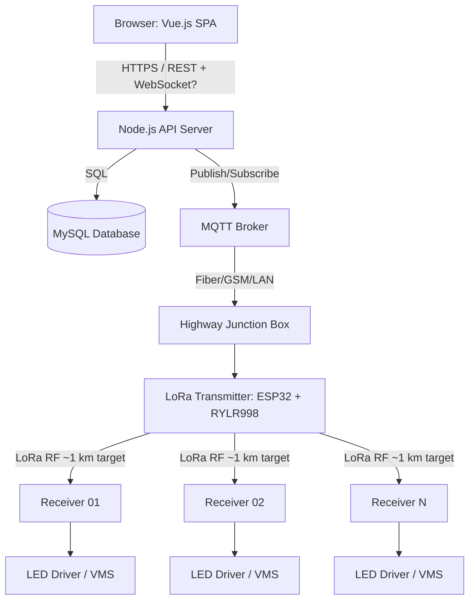
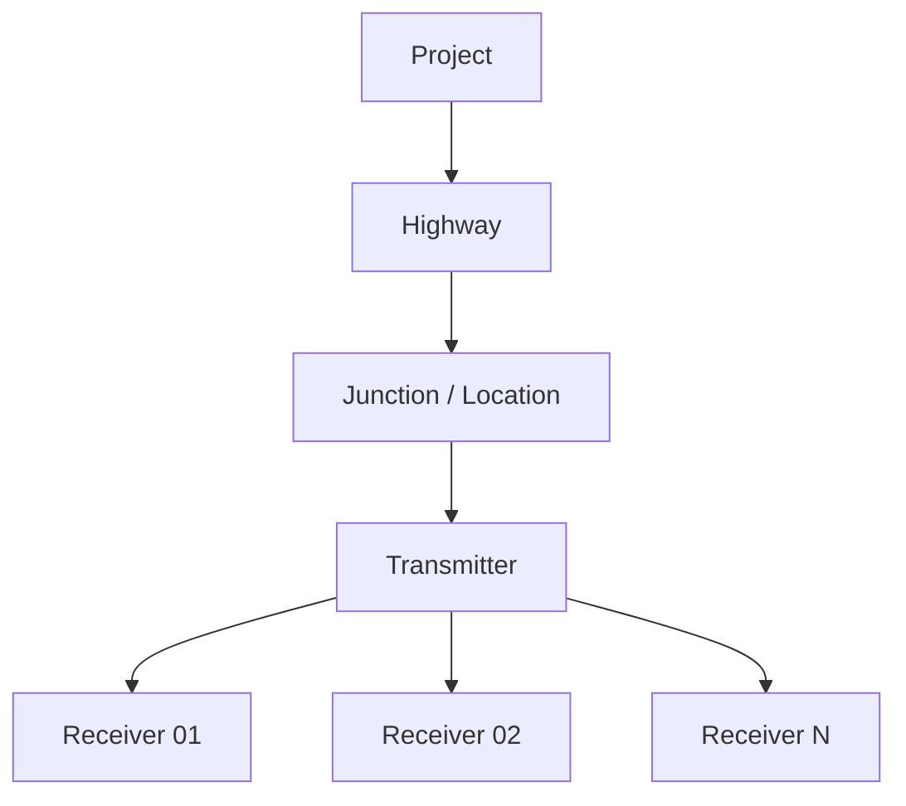
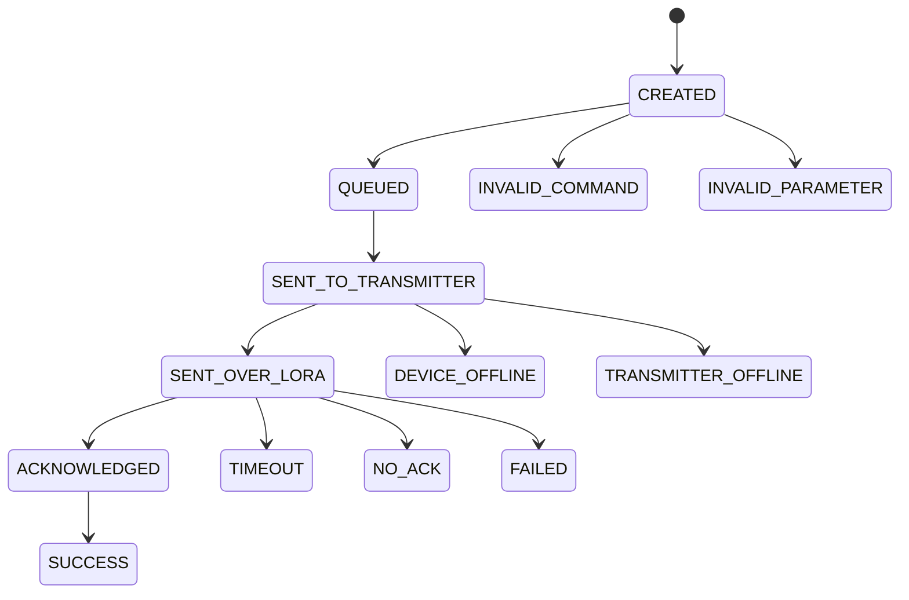
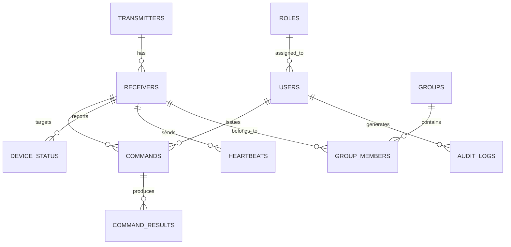

# SRS – LoRa-Based Highway LED Control & Monitoring System

## Technology Stack: Node.js · Vue.js · MySQL

2026-09-18 · @Someone

## Document Control

| Field | Value |
| --- | --- |
| Document Title | SRS – LoRa-Based Highway LED Control & Monitoring System |
| Document Type | Software Requirements Specification (IEEE 830-style) |
| Version | 0.1 (Draft) |
| Status | **DRAFT – derived from PRD v0.1, pending Open Issues resolution** |
| Technology Stack | Node.js (backend/API), Vue.js (frontend SPA), MySQL (database) |
| Related Document | PRD – LoRa-Based Highway LED Control & Monitoring System (v0.1) |
| Date | 2026-09-18 |

### Revision History

| Version | Date | Description |
| --- | --- | --- |
| 0.1 | 2026-09-18 | Initial SRS derived from the project PRD, with backend/frontend/database technology now fixed to Node.js / Vue.js / MySQL. Embedded/protocol facts inherited unchanged from the PRD's source-of-truth excerpts of `integration_protocol.doc` and `RYLR998_TX_TEST.ino`; those files still require full review before this SRS is finalized. |

## 1. Introduction

### 1.1 Purpose

This SRS specifies the software requirements for the Web Dashboard, Backend/API, and Database layers of the Highway LED Control & Monitoring System, to be implemented using **Node.js** (backend), **Vue.js** (frontend), and **MySQL** (database). It translates the PRD's product-level requirements into requirements precise enough to design and build against, while preserving the PRD's source-of-truth boundaries around the existing ESP32/LoRa/MQTT embedded system.

### 1.2 Scope

In scope: Node.js REST API backend, Vue.js single-page dashboard application, MySQL relational database, and their integration with the existing MQTT broker / LoRa transmitter architecture described in the PRD. Out of scope: embedded firmware changes (tracked as "Possible Firmware Enhancements" in the PRD), receiver hardware design.

### 1.3 Definitions, Acronyms, and Abbreviations

See Glossary (final section). Key ones: **SPA** – Single Page Application; **REST** – Representational State Transfer; **ORM** – Object-Relational Mapper; **JWT** – JSON Web Token; **RBAC** – Role-Based Access Control.

### 1.4 References

- PRD – LoRa-Based Highway LED Control & Monitoring System (v0.1)
- Integration Protocol Document (`integration_protocol.doc`) – not yet fully reviewed, see Open Issues
- Transmitter Firmware (`RYLR998_TX_TEST.ino`) – not yet fully reviewed, see Open Issues

### 1.5 Overview

§2 describes the system at a product level with the chosen stack; §3 gives the concrete architecture; §4–§8 specify functional requirements by area; §9 specifies external interfaces (API/MQTT/DB); §10 specifies the MySQL schema; §11 specifies non-functional requirements; §12 specifies verification; §13 lists open issues; §14 closes with assumptions and glossary.

## 2. Overall Description

### 2.1 Product Perspective

The software system is a new **Vue.js SPA + Node.js API + MySQL database** stack sitting in front of the existing ESP32/RYLR998 LoRa transmitter fleet, which communicates over MQTT. The software system does not replace or modify existing embedded behavior; it is a new client/server application that consumes MQTT telemetry and issues MQTT commands per the protocol documented in the PRD (§2 there).

### 2.2 Product Functions (summary)

- Authenticate users and enforce role-based access (Admin/Operator/User).
- Display highway/junction/transmitter/receiver hierarchy and live device status.
- Issue individual and group device commands (brightness, relay) and track per-device results.
- Record command history, audit logs, and communication health (RSSI/SNR, online/offline).
- Allow Admin configuration of status-monitoring parameters, devices, groups, and users.

### 2.3 User Classes and Characteristics

| Class | Characteristics |
| --- | --- |
| Administrator | Technical/operations staff; full configuration and user-management access |
| Operator | Field/control-room staff; operates devices, no admin configuration |
| User | Limited/read-mostly access; views status, performs only explicitly authorized actions |

### 2.4 Operating Environment

| Layer | Technology | Notes |
| --- | --- | --- |
| Frontend | Vue.js (SPA) | Version — **TBD** (Vue 3 recommended default; not yet confirmed with client) |
| Backend | Node.js | Version — **TBD**; framework (Express/Fastify/NestJS) — **TBD** |
| Database | MySQL | Version — **TBD**; ORM/query layer — **TBD** |
| Messaging | MQTT broker | Product/version — **TBD** (per PRD Open Issue: "Final MQTT broker") |
| Client browsers | TBD | Minimum supported versions not yet specified |
| Hosting | TBD | On-prem vs. cloud not yet specified |

### 2.5 Design and Implementation Constraints

- The existing embedded firmware and integration protocol (AT commands, `esp/sub`/`esp/pub` topics, `Tx_<addr>_<cmd>` syntax, JSON telemetry shape) are **fixed inputs** — the Node.js backend must consume them as-is; it must not assume the firmware will change to suit the backend design.
- The dashboard (Vue.js) must **never** be able to send raw LoRa/AT commands directly — all device commands must pass through the Node.js backend's validated command API (inherits PRD SEC-CRITICAL).
- Authorization must be enforced in Node.js middleware/backend logic, not only in Vue.js route guards or UI conditionals.

### 2.6 Assumptions and Dependencies

- An MQTT broker reachable by both the Node.js backend and the field transmitters will be available; its identity is TBD (PRD Open Issue).
- A MySQL instance/version will be provisioned; exact version TBD.
- The full `integration_protocol.doc` and `RYLR998_TX_TEST.ino` files will be supplied for validation before this SRS is finalized (inherited from PRD).

## 3. System Architecture



### 3.1 Technology Stack

| Component | Technology | Responsibility |
| --- | --- | --- |
| Frontend | Vue.js (SPA) | Dashboard UI, role-aware views, device control forms, status visualization |
| Backend | Node.js (framework TBD: Express/Fastify/NestJS) | REST API, authentication/authorization, command queue, MQTT client, business logic |
| Database | MySQL | Persistent storage — users, devices, groups, commands, status history, audit logs |
| Messaging | MQTT broker (product TBD) | Transport between Node.js backend and field transmitters |
| ORM/Query layer | TBD (e.g. Sequelize, Prisma, Knex, or raw `mysql2`) | Node.js ↔ MySQL data access |
| Auth | TBD (JWT recommended default, not yet confirmed) | Session/token issuance and validation |

### 3.2 Layered Responsibility

- **Vue.js** owns presentation only: it renders state received from the Node.js API and never talks to MQTT or MySQL directly.
- **Node.js** owns all business logic: authentication, RBAC enforcement, command lifecycle management, MQTT publish/subscribe, and all MySQL access.
- **MySQL** is the system of record for users, device inventory, groups, command history, and audit logs. It does not hold live/ephemeral telemetry state beyond "last known" snapshots (heartbeat, last status) — real-time push mechanism (polling vs. WebSocket/SSE) is **TBD**.

### 3.3 Field Deployment Hierarchy (inherited from PRD)



The MySQL schema (§10) mirrors this hierarchy.

## 4. Functional Requirements — Devices & Communication

### 4.1 Transmitter & Receiver Management (FR-DEV)

| ID | Requirement | Implementation Note |
| --- | --- | --- |
| FR-DEV-001 | Node.js backend shall maintain a registry of transmitters and receivers in MySQL | Table: `transmitters`, `receivers` (§10) |
| FR-DEV-002 | Admin (via Vue.js UI) shall be able to add/edit/disable transmitters and receivers | Calls `POST/PUT /api/devices` |
| FR-DEV-003 | Each receiver's Device ID shall be stored separately from its numeric LoRa Address | Per PRD §10 addressing model — do not assume identity |
| FR-DEV-004 | Node.js backend shall associate every receiver with exactly one parent transmitter | FK constraint in MySQL schema |

### 4.2 LoRa Communication (FR-LORA)

| ID | Requirement | Implementation Note |
| --- | --- | --- |
| FR-LORA-001 | Backend shall treat the current addressed command format `Tx_<ReceiverAddress>_<Command>` as fixed protocol, not to be altered | Node.js command-builder module |
| FR-LORA-002 | Backend shall NOT assume any range/behavior beyond what is documented in the PRD's Existing Embedded System section | Source-of-truth constraint |
| FR-LORA-003 | Final RF power, receivers-per-transmitter limits | **TBD**, inherited PRD Open Issue |

### 4.3 MQTT Integration (FR-MQTT)

| ID | Requirement | Implementation Note |
| --- | --- | --- |
| FR-MQTT-001 | Node.js backend shall run a persistent MQTT client subscribing to transmitter response topics (`esp/pub/<address>`) | e.g. via `mqtt` npm package |
| FR-MQTT-002 | Node.js backend shall publish commands to `esp/sub/<address>` |  |
| FR-MQTT-003 | Backend shall support consuming the `Factory/Lighting/Device<Address>/...` topic structure where applicable | Relationship to `esp/sub`/`esp/pub` is an **Open Issue** (§13) — do not unify silently |
| FR-MQTT-004 | Backend shall parse status JSON `{relay1, relay2, brightness}` and ACK JSON `{source, message, rssi, snr}` exactly as documented, with no invented fields |  |
| FR-MQTT-005 | MQTT broker connection credentials shall be stored securely (not in source control) | Node.js env/secrets config — mechanism **TBD** |

### 4.4 Device Addressing (FR-ADDR)

Each device record in MySQL shall carry: `device_id` (PK), `device_name`, `lora_address`, `network_id`, `parent_transmitter_id` (FK), `location`. The Vue.js UI shall never let an operator conflate `device_id` with `lora_address`.

## 5. Functional Requirements — Device Control

### 5.1 Individual Device Control (FR-CTL)

| ID | Requirement |
| --- | --- |
| FR-CTL-001 | Vue.js UI shall allow selecting a single device and submitting a brightness/relay command |
| FR-CTL-002 | Node.js backend shall validate the command and parameter range before dispatching over MQTT (e.g. reject out-of-range brightness) |
| FR-CTL-003 | Backend shall return the command result to the Vue.js client (success/failure/timeout) |

### 5.2 Group / Multi-Device Control (FR-GRP)

| ID | Requirement |
| --- | --- |
| FR-GRP-001 | Vue.js UI shall allow selecting a group and submitting a command to all member devices |
| FR-GRP-002 | Node.js backend shall dispatch the command to each device individually and track **per-device** results in MySQL (`command_results` table) |
| FR-GRP-003 | Backend shall compute an aggregate group result: `SUCCESS` (all succeeded), `PARTIAL_SUCCESS` (mixed), `FAILED` (all failed) |
| FR-GRP-004 | The exact group/broadcast LoRa transmission mechanism is **TBD** pending final LoRa protocol confirmation |

### 5.3 Command Transaction Model (FR-CMD)



Implemented as a Node.js command-queue service that writes state transitions to the MySQL `commands` table; final failure-state naming must align with the actual embedded protocol once fully reviewed.

### 5.4 Command Audit Trail (FR-AUDIT)

Every command row in MySQL shall store: `command_id`, `created_at`, `user_id`, `user_role`, `transmitter_id`, `receiver_id`, `command`, `parameter`, `source`, `transmission_status`, `acknowledged`, `rssi`, `snr`, `final_result`, `error_code`. The Vue.js Logs page shall query this table via `GET /api/audit`.

## 6. Functional Requirements — Status & Health Monitoring

### 6.1 Monitoring Mechanisms (FR-MON)

| ID | Requirement |
| --- | --- |
| FR-MON-001 | Node.js backend shall record every heartbeat message received via MQTT to MySQL (`heartbeats` table) |
| FR-MON-002 | Backend shall support a scheduled job (e.g. `node-cron` or equivalent) that performs periodic status requests, when enabled |
| FR-MON-003 | Backend shall keep Heartbeat, Status Request, Status Response, Online/Offline State, Command Acknowledgement, and Fault/Error Information as **distinct, separately queryable records** — never conflated into one field |

### 6.2 Admin-Configurable Monitoring (FR-MONCFG) — key business requirement

| Parameter | Storage | Default |
| --- | --- | --- |
| Status Monitoring Enable/Disable | MySQL `monitoring_config` table | TBD |
| Polling Interval | MySQL `monitoring_config` | TBD |
| Response Timeout | MySQL `monitoring_config` | TBD |
| Retry Count | MySQL `monitoring_config` | TBD |
| Offline Threshold | MySQL `monitoring_config` | TBD |
| Status Polling Mode | MySQL `monitoring_config` | TBD |

The Vue.js Admin Configuration page shall read/write these via `GET/PUT /api/status-monitoring`. Configuration hierarchy (System/Transmitter/Group/Device level) is **TBD**.

### 6.3 Heartbeat (FR-HB)

Current embedded heartbeat interval: **30 seconds** (protocol-defined, believed hard-coded). Making this configurable from the Vue.js dashboard is a **future firmware-dependent requirement**, not guaranteed achievable without a firmware change — tracked in Open Issues (§13).

### 6.4 Online/Offline Determination (FR-ONOFF)

Node.js backend shall combine: MQTT retained online-state/LWT, last heartbeat timestamp, last LoRa status-response timestamp, and configured offline threshold, to compute a single `online`/`offline` state exposed via `GET /api/devices/{id}/status`. The exact combination algorithm is **TBD** — not invented here; a placeholder "last-seen exceeds threshold → offline" rule may be used for early development but must be confirmed.

### 6.5 Device Status Fields (Dashboard minimum)

Device ID, Device Name, Parent Transmitter, Location, Online/Offline, Last Seen, Last Status Response, Brightness, Relay 1/2 Status, LoRa RSSI, LoRa SNR, Firmware Version, Network ID, LoRa Address — sourced from MySQL `device_status` (latest snapshot) joined with `devices`.

## 7. Functional Requirements — Vue.js Dashboard

| ID | Page / View | Key Vue Components (illustrative) | Backing API |
| --- | --- | --- | --- |
| FR-UI-001 | Login | `LoginForm.vue` | `POST /api/auth/login` |
| FR-UI-002 | Main Dashboard | `SummaryCards.vue`, `RecentCommands.vue` | `GET /api/devices`, `GET /api/logs` |
| FR-UI-003 | Highway/Junction View | `DeviceTree.vue` | `GET /api/devices` (hierarchical) |
| FR-UI-004 | Device Management (Admin) | `DeviceForm.vue`, `DeviceList.vue` | `GET/POST/PUT /api/devices` |
| FR-UI-005 | Device Control | `BrightnessSlider.vue`, `RelayToggle.vue`, `CommandResult.vue` | `POST /api/devices/{id}/commands` |
| FR-UI-006 | Group Management (Admin) | `GroupForm.vue`, `GroupMemberPicker.vue` | `POST /api/groups`, `POST /api/groups/{id}/commands` |
| FR-UI-007 | Status Monitoring | `StatusTable.vue`, `RssiSnrBadge.vue` | `GET /api/devices/{id}/status` |
| FR-UI-008 | Configuration (Admin-only) | `MonitoringConfigForm.vue`, `LoraConfigForm.vue` | `GET/PUT /api/status-monitoring` |
| FR-UI-009 | User Management (Admin) | `UserForm.vue`, `RoleSelector.vue` | `GET/POST/PUT /api/users` |
| FR-UI-010 | Logs | `AuditLogTable.vue`, `CommandLogTable.vue` | `GET /api/logs`, `GET /api/audit` |

### 7.1 State Management & Routing (implementation notes, TBD to confirm)

- Vue Router for page navigation, guarded by role (route-level check is a UX convenience only — never a security boundary; §11.2 SEC-CRITICAL).
- A centralized store (Pinia/Vuex — **TBD** which) for auth/session state, device list cache, and live status.
- Real-time update mechanism (polling interval vs. WebSocket/SSE push from Node.js) is **TBD**; polling is the safe default assumption until confirmed.

### 7.2 Group Command Result Display

Per PRD §5, the group command result shown in `CommandResult.vue` shall render `PARTIAL_SUCCESS` distinctly (e.g. amber state) from full `SUCCESS`/`FAILED`, with an expandable per-device breakdown.

## 8. Functional Requirements — User & Permission Management

### 8.1 Roles

Three roles, enforced by Node.js middleware on every protected route: **Administrator**, **Operator**, **User**.

### 8.2 Role-Permission Matrix

| Function | Admin | Operator | User |
| --- | --- | --- | --- |
| Login | Yes | Yes | Yes |
| View Dashboard | Yes | Yes | Yes |
| View Devices | Yes | Yes | Yes |
| Add Device | Yes | No | No |
| Delete Device | Yes | No | No |
| Configure LoRa | Yes | No | No |
| Configure MQTT | Yes | No | No |
| Configure Status Monitoring | Yes | No | No |
| Set Brightness | Yes | Yes | Configurable |
| Relay Control | Yes | Yes | Configurable |
| Group Control | Yes | Yes | Configurable |
| View Logs | Yes | Limited | No |
| User Management | Yes | No | No |
| System Settings | Yes | No | No |

### 8.3 Authentication & Authorization (FR-AUTH)

| ID | Requirement |
| --- | --- |
| FR-AUTH-001 | Node.js backend shall issue a session token on successful login (mechanism **TBD**: JWT recommended default) |
| FR-AUTH-002 | Passwords shall be hashed (e.g. bcrypt/argon2 — **TBD** which) before storage in MySQL `users` table; plaintext passwords shall never be stored or logged |
| FR-AUTH-003 | Every protected Node.js route shall verify the caller's role server-side before executing; the Vue.js UI hiding a button is **not** a substitute for this check |
| FR-AUTH-004 | Session/token expiry (timeout) value is **TBD** |

### 8.4 User Management (Admin)

Create user, edit user, disable user, assign role, assign permissions, reset password — all via `POST/PUT /api/users` endpoints, MySQL `users` and `roles` tables.

## 9. External Interface Requirements

### 9.1 REST API (Node.js) — proposed, not yet implemented

```
POST   /api/auth/login

GET    /api/devices
GET    /api/devices/{id}
POST   /api/devices
PUT    /api/devices/{id}

POST   /api/devices/{id}/commands
POST   /api/groups/{id}/commands

GET    /api/devices/{id}/status
GET    /api/transmitters/{id}/status

GET    /api/logs
GET    /api/audit

GET    /api/status-monitoring
PUT    /api/status-monitoring

GET    /api/users
POST   /api/users
PUT    /api/users/{id}
```

**Conventions:** JSON request/response bodies; standard HTTP status codes (200/201/400/401/403/404/409/500); every mutating endpoint requires an authenticated session and is role-checked server-side; error responses shall follow a consistent shape (`{ "error": { "code": ..., "message": ... } }` — exact shape **TBD**).

### 9.2 MQTT Interface (Node.js ↔ Broker ↔ Transmitter)

| Direction | Topic | Payload |
| --- | --- | --- |
| Backend → Transmitter | `esp/sub/<address>` | Command string, e.g. `Tx_4_LUX_30` |
| Transmitter → Backend | `esp/pub/<address>` | `{ "source": 4, "message": "ACK:R1ON", "rssi": -70, "snr": 8 }` |
| Transmitter → Backend (protocol, relationship TBD) | `Factory/Lighting/Device<Address>/Status` etc. | Per integration protocol |

The Node.js backend's MQTT client library, QoS level, and reconnection/backoff strategy are **TBD**.

### 9.3 Database Interface (Node.js ↔ MySQL)

- Connection pooling required (library **TBD**: `mysql2`, Sequelize, Prisma, Knex).
- All device-command writes and status reads shall use parameterized queries — no string-concatenated SQL (SEC requirement, §11.2).
- Migration/versioning tool for schema changes is **TBD**.

### 9.4 Vue.js ↔ Node.js Contract

All frontend/backend communication goes through the REST API in §9.1 (plus an optional real-time channel, mechanism TBD). The Vue.js app never connects to MySQL or the MQTT broker directly.

## 10. Database Requirements (MySQL)

Proposed logical schema — exact column types/constraints/indexes to be finalized during implementation.



### 10.1 Core Tables

| Table | Key Columns |
| --- | --- |
| `users` | id, username, password\_hash, role\_id, status, created\_at |
| `roles` | id, name (Admin/Operator/User) |
| `transmitters` | id, name, junction\_id, network\_id, connectivity\_type, status |
| `receivers` | id, device\_name, lora\_address, network\_id, parent\_transmitter\_id, location, status |
| `groups` | id, name |
| `group_members` | group\_id, receiver\_id |
| `commands` | id, user\_id, transmitter\_id, receiver\_id, command, parameter, status, created\_at |
| `command_results` | id, command\_id, receiver\_id, result, rssi, snr, acknowledged\_at |
| `device_status` | id, receiver\_id, online, brightness, relay1, relay2, last\_seen, last\_status\_at |
| `heartbeats` | id, receiver\_id, received\_at |
| `monitoring_config` | id, scope\_type (system/transmitter/group/device), scope\_id, enabled, polling\_interval, response\_timeout, retry\_count, offline\_threshold |
| `audit_logs` | id, user\_id, action, entity\_type, entity\_id, details, created\_at |

### 10.2 Notes

- `device_status` holds the **latest snapshot** per receiver, not full history; history lives in `heartbeats` and `command_results`.
- Foreign keys enforce the Highway → Junction → Transmitter → Receiver hierarchy at the `transmitters`/`receivers` level; Highway/Junction as first-class tables vs. free-text fields on `transmitters` is **TBD**.
- Indexing strategy, retention policy for `audit_logs`/`heartbeats`, and exact MySQL storage engine/charset are **TBD**.

## 11. Non-Functional Requirements

### 11.1 Performance (targets TBD — none invented)

| Parameter | Requirement |
| --- | --- |
| Node.js API response time | TBD |
| Vue.js dashboard initial load time | TBD |
| Maximum transmitters | TBD |
| Maximum receivers/transmitter | TBD |
| Maximum total devices | TBD |
| Command timeout | TBD |
| Status polling interval | Configurable/TBD |
| Concurrent users | TBD |
| MySQL data retention | TBD |

### 11.2 Security

| ID | Requirement |
| --- | --- |
| SEC-001 | HTTPS shall be enforced for all Vue.js ↔ Node.js traffic |
| SEC-002 | Passwords hashed (bcrypt/argon2, TBD) before MySQL storage |
| SEC-003 | Role-based access control enforced server-side (Node.js middleware), not only in Vue.js |
| SEC-004 | All SQL access parameterized; no string-built queries (SQL injection prevention) |
| SEC-005 | Session/token timeout enforced |
| SEC-006 | Input validation on every Node.js API endpoint (body/param/query) |
| SEC-007 | MQTT broker credentials and MySQL credentials stored in environment/secrets configuration, never committed to source control |
| SEC-008 (**CRITICAL**) | The Vue.js dashboard shall never be able to send raw LoRa/AT commands to field equipment through normal operator access; only the validated Node.js command API may do so |
| SEC-009 | Every mutating action recorded to `audit_logs` |

### 11.3 Reliability & Failure Handling

| Failure Mode | Expected Behavior |
| --- | --- |
| Node.js ↔ MySQL connection loss | Backend returns 5xx with retry/backoff; Vue.js shows a connectivity error state |
| Node.js ↔ MQTT broker disconnect | Node.js MQTT client reconnects automatically (strategy TBD); device status marked stale, not falsely "offline" |
| Transmitter ↔ LoRa receiver no response | Backend records `TIMEOUT`; Vue.js shows `NO RESPONSE / TIMEOUT` |
| Partial group command failure | Backend computes `PARTIAL_SUCCESS`; Vue.js renders per-device breakdown |

### 11.4 Usability

Vue.js UI shall follow consistent component patterns across pages (forms, tables, status badges); minimum supported browsers **TBD**; responsive/mobile support **TBD**.

### 11.5 Maintainability & Scalability

Node.js backend shall be organized into clear modules (routes/controllers, services, MQTT layer, data-access layer); Vue.js frontend shall use component-based structure with a shared API client layer. Horizontal scaling approach for the Node.js API (stateless vs. sticky sessions) is **TBD**, relevant if a real-time push channel is added (§7.1).

## 12. Verification

### 12.1 Test Cases

| ID | Test | Expected Result |
| --- | --- | --- |
| TC-001 | Login (valid user) | Node.js issues session token; Vue.js redirects to dashboard |
| TC-002 | Login (invalid credentials) | Node.js returns 401; Vue.js shows error, no token issued |
| TC-003 | Brightness control | Vue.js submits brightness → Node.js validates → MQTT command sent → receiver ACKs → MySQL updated → Vue.js reflects new state |
| TC-004 | Individual device command | Command to RX001 only — RX002 unaffected |
| TC-005 | Group command | Command to group → all member devices receive it |
| TC-006 | Partial group failure | One receiver times out → Node.js records `PARTIAL_SUCCESS` → Vue.js shows per-device breakdown |
| TC-007 | Status monitoring | Configured polling interval → Node.js scheduled job executes |
| TC-008 | Offline detection | Receiver stops responding → backend marks offline per configured threshold |
| TC-009 | RSSI/SNR capture | ACK contains rssi/snr → stored in MySQL, displayed in Vue.js |
| TC-010 | MQTT reconnection | Broker connection drops → Node.js MQTT client reconnects |
| TC-011 | Unauthorized API call | Operator token calls an Admin-only endpoint directly (bypassing UI) → Node.js returns 403 |
| TC-012 | SQL injection attempt | Malicious input in a form field → rejected/sanitized, no query execution |

### 12.2 Traceability Matrix (illustrative)

| Req ID | Requirement | Node.js Module | Vue.js Component | MySQL Table(s) | Test |
| --- | --- | --- | --- | --- | --- |
| FR-CTL-001 | Individual brightness control | `commandService` | `BrightnessSlider.vue` | `commands`, `command_results` | TC-003 |
| FR-GRP-002 | Group command per-device tracking | `groupCommandService` | `CommandResult.vue` | `commands`, `command_results` | TC-005, TC-006 |
| FR-MONCFG | Configurable monitoring | `monitoringConfigController` | `MonitoringConfigForm.vue` | `monitoring_config` | TC-007, TC-008 |
| SEC-003 | Server-side RBAC | `authMiddleware` | (all protected views) | `users`, `roles` | TC-011 |
| SEC-004 | Parameterized SQL | data-access layer | — | all | TC-012 |

This table is illustrative and shall be expanded to cover every requirement ID in §4–§11 as design matures.

## 13. Open Issues / Clarifications

### 13.1 Carried over from the PRD (unresolved)

1. Complete `integration_protocol.doc` and `RYLR998_TX_TEST.ino` not yet fully reviewed against this SRS.
2. Final Receiver firmware implementation.
3. **Brightness range conflict:** firmware validates 1–99; protocol describes 0–100%.
4. MQTT topic relationship: `esp/sub`/`esp/pub` vs. `Factory/Lighting/Device<Address>/...`.
5. Heartbeat configurability — firmware change required or not.
6. Offline threshold, status polling interval, response timeout, retry count — default values.
7. Final RF power, receivers-per-transmitter limit, LoRa range acceptance criteria.
8. Final network hardware per site (Fiber/GSM/LAN) and final MQTT broker.
9. Group command transmission mechanism (sequential/broadcast/other).
10. Required alerts/notification channels.
11. Firmware update mechanism (OTA or manual).
12. Device configuration: dashboard-driven vs. local configuration portal.

### 13.2 Stack-Specific (new for this SRS)

13. **Node.js framework**: Express vs. Fastify vs. NestJS — not selected.
14. **ORM/query layer"€” Sequelize vs. Prisma vs. Knex vs. raw `mysql2` — not selected.
15. **Auth mechanism**: JWT vs. server-side session store — not selected; token/session expiry not defined.
16. **Password hashing library**: bcrypt vs. argon2 — not selected.
17. **Real-time update channel**: polling vs. WebSocket/Socket.IO vs. Server-Sent Events — not selected.
18. **Vue.js version**: Vue 2 vs. Vue 3 — not confirmed with client.
19. **State management library**: Pinia vs. Vuex — not selected.
20. **MySQL version and hosting**: managed service vs. self-hosted — not selected.
21. **Deployment/hosting target** for Node.js and Vue.js build (on-prem, cloud, containerized) — not selected.
22. **CI/CD pipeline** — not defined.
23. **Node.js MQTT client library** and QoS/reconnection strategy — not selected.

None of the above are resolved by assumption in this document; defaults are noted only where explicitly marked "recommended default, not confirmed."

## 14. Assumptions, Appendix & Glossary

### 14.1 Assumptions & Dependencies

- Node.js, Vue.js, and MySQL versions will be pinned once hosting/deployment decisions are made (Open Issue §13.2).
- The MQTT broker and its credentials will be provisioned and reachable from the Node.js backend.
- The existing embedded firmware and integration protocol remain unchanged during this software's development, or any changes will be communicated and reconciled against §4/§6/§9.2.
- This SRS inherits all assumptions listed in the PRD §14.

### 14.2 Glossary

| Term | Definition |
| --- | --- |
| SPA | Single Page Application (the Vue.js frontend) |
| REST | Representational State Transfer — the Node.js API style |
| ORM | Object-Relational Mapper — maps Node.js objects to MySQL rows |
| JWT | JSON Web Token — candidate auth token format |
| RBAC | Role-Based Access Control |
| LoRa | Long Range — low-power wide-area RF protocol used by the transmitter/receivers |
| MQTT | Message Queuing Telemetry Transport |
| RSSI / SNR | Received Signal Strength Indicator / Signal-to-Noise Ratio |
| LWT | MQTT Last Will and Testament |
| Connection pool | Reused set of Node.js ↔ MySQL connections for efficiency |
| TBD | To Be Determined — explicitly unresolved |

---

*This SRS (v0.1, Draft) is derived from the project PRD with the Node.js / Vue.js / MySQL stack now fixed. It must be reconciled against the complete `integration_protocol.doc` and `RYLR998_TX_TEST.ino` files, and the Open Issues in §13 resolved (including all stack-specific selections), before development sign-off.*
